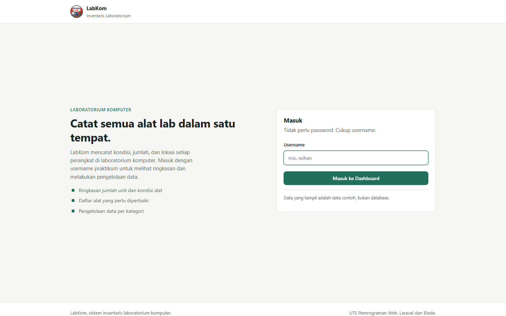
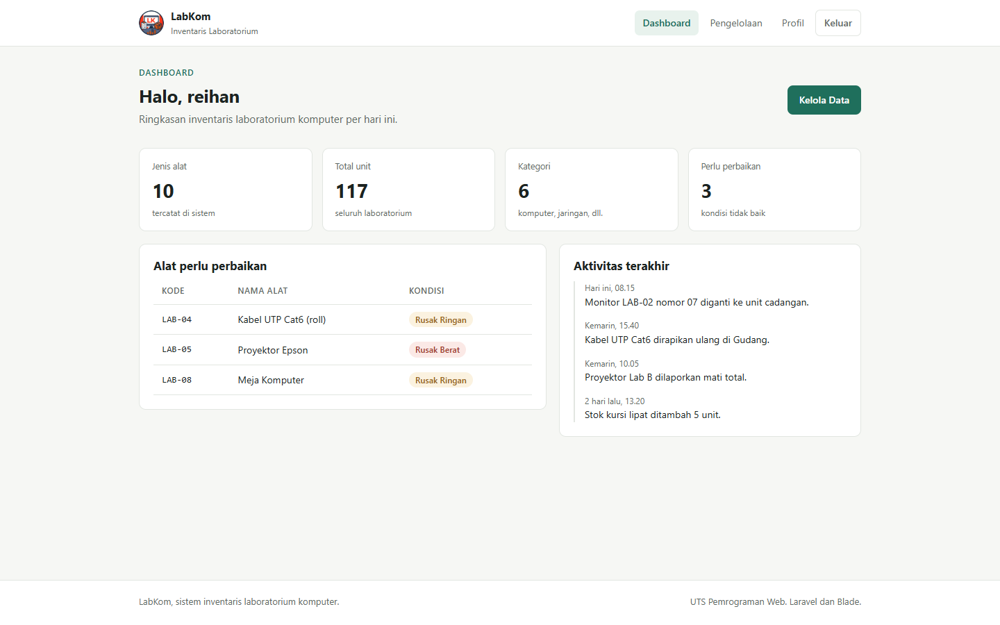
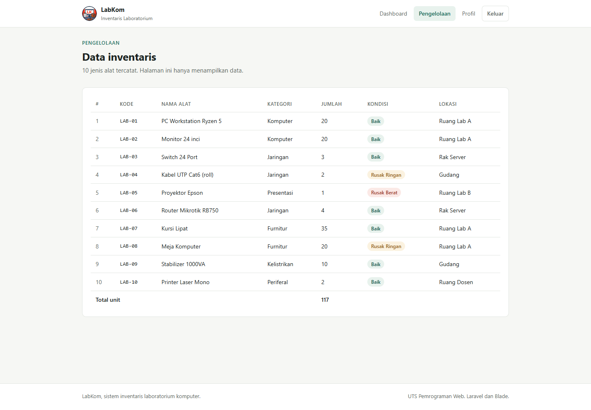
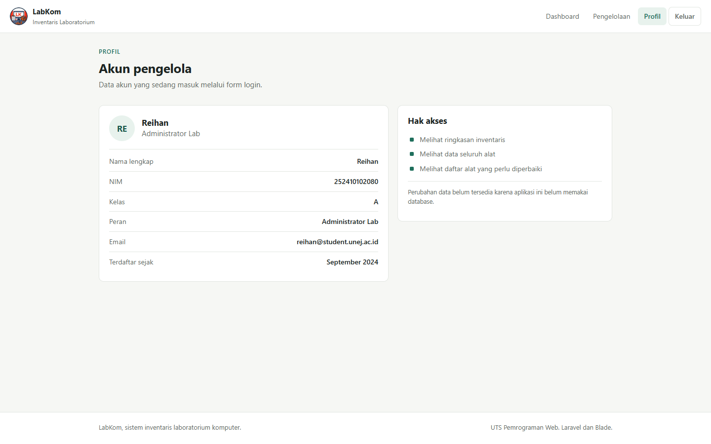
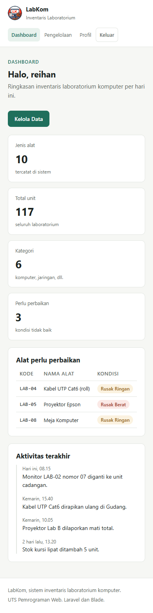

# UTS Pemrograman Web: LabKom

Aplikasi inventaris laboratorium komputer. Dibuat dengan Laravel 13 murni, tanpa
starter kit dan tanpa database. Data alat disimpan sebagai array di controller.

**Nama:** Mohammad Reihan Islami Wijaya
**NIM:** 252410102080
**Kelas:** A

## Tema pengelolaan

LabKom mencatat alat yang ada di laboratorium komputer: kode, nama, kategori,
jumlah unit, kondisi, dan lokasi penyimpanan. Dari data itu diturunkan beberapa
angka ringkasan (jumlah jenis alat, total unit, jumlah kategori, alat yang perlu
diperbaikan) yang tampil di dashboard.

## Alur aplikasi

1. `/login` untuk form username. Tidak ada password, hanya simulasi login.
2. `POST /login`, controller memvalidasi username lalu redirect ke
   `/dashboard?username=...`. Username ikut sebagai query string.
3. `/dashboard` menampilkan sapaan memakai username, kartu ringkasan, dan daftar
   alat rusak.
4. `/pengelolaan` menampilkan tabel seluruh alat, dirender dengan `@foreach`.
5. `/profile` menampilkan data akun, memakai username yang sama.

Halaman selain login akan redirect ke `/login` kalau dibuka tanpa `?username=`.
Ini pengganti middleware auth, karena UTS ini belum memakai autentikasi Laravel.

## Struktur file

```
├── routes/
│   └── web.php
│
├── app/Http/Controllers/
│   └── PageController.php
│
├── resources/views/
│   ├── layouts/
│   │   └── app.blade.php
│   │
│   ├── login.blade.php
│   ├── dashboard.blade.php
│   ├── pengelolaan.blade.php
│   ├── profile.blade.php
│   │
│   └── components/
│       ├── navbar.blade.php
│       └── footer.blade.php
│
├── public/css/app.css
└── public/images/logo.jpg
```

## Mengganti logo navbar

Taruh file gambar di `public/images/logo.jpg`. Kalau file itu ada, navbar
otomatis memakainya. Kalau tidak ada, navbar kembali menampilkan kotak "LK".
Ukuran tampil 36x36 px, jadi pakai gambar persegi minimal 72x72 px. Format
bebas (jpg, png, svg), asal namanya `logo.jpg`.

## Blade yang dipakai

| Direktif | Di mana |
| --- | --- |
| `@extends` | keempat view |
| `@section` / `@endsection` | keempat view |
| `@yield` | `layouts/app.blade.php` (judul & konten) |
| `@include` | `layouts/app.blade.php` → `components/footer` |
| `<x-navbar>` `<x-footer>` | `layouts/app.blade.php` |
| `@foreach` | dashboard (aktivitas), pengelolaan (tabel), profile (detail) |
| `@forelse` | dashboard (daftar alat rusak) |
| `@error` | login |

## Screenshot

| Login | Dashboard |
| --- | --- |
|  |  |

| Pengelolaan | Profil |
| --- | --- |
|  |  |

Tampilan mobile (390px):



